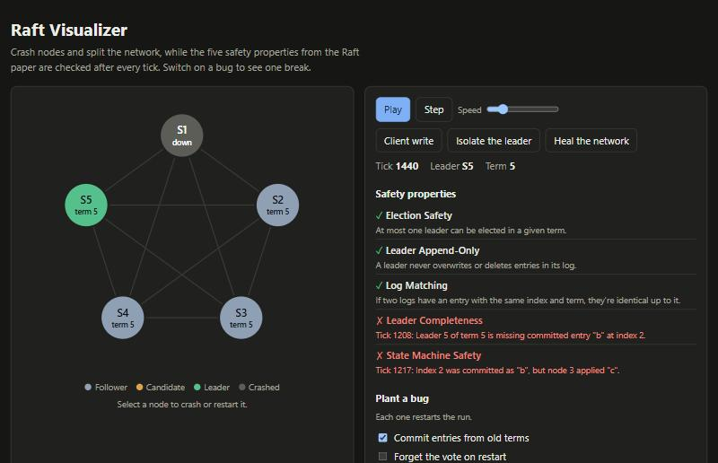

# raft-visualizer

[](https://github.com/Urthella/raft-visualizer/actions/workflows/ci.yml)

**[Try it in your browser](https://urthella.github.io/raft-visualizer/)**

Raft in the browser. Crash nodes and split the network while the five safety properties from the
[Raft paper](https://raft.github.io/raft.pdf) are checked after every tick. Then switch on a bug and
watch one break.



[RaftScope](https://raft.github.io/raftscope/) is the classic way to see Raft run, and it's great for
that. What this adds is the checking: it shows you when the algorithm is safe, not only what it's doing.

## Figure 8

The most subtle rule in Raft is that a leader may only count replicas to commit entries from its own term.
Figure 8 of the paper shows why, and it's hard to take in from a diagram. Here you can walk through it:

1. Node 1 replicates entry “b”, but only as far as node 2.
2. Node 5 wins an election and appends a different entry at the same index.
3. Node 1 comes back and copies “b” to a third node. “b” is now on a majority of nodes.
4. Node 5 comes back, wins again, and overwrites “b” everywhere.

Run it with the rule in place and nothing goes wrong, because “b” never counted as committed. Run it with
**Commit entries from old terms** switched on, and the panel shows that committed data is gone:

> **State Machine Safety.** Index 2 was committed as "b", but node 3 applied "c".

## Run it locally

```bash
npm install
npm run build
python3 -m http.server
```

Then open <http://localhost:8000>. It has no runtime dependencies.

## What's in it

- **`src/raft.ts`:** the simulator, following Figure 2 of the paper. Time moves in ticks and all randomness
  comes from a seed, so the same seed gives the same run.
- **`src/invariants.ts`:** the five properties from Figure 3 of the paper, checked after every tick.
- **`src/figure8.ts`:** the scenario above, which the tests and the page both use.
- **`src/ui.ts`:** the page, with no framework.

## Tests

```bash
npm test
```

The properties are checked through random crashes and partitions on 60 seeds, and every node has to reach
the same data once the faults stop. The Figure 8 scenario runs with and without the bug.

Green lights only mean something if the checker can go red, so bugs were planted in a copy of the code one
at a time, and all 11 were caught. They included a two-vote election, committing without a majority,
keeping conflicting entries, and a checker that ignored two leaders in one term. The tests that caught them
are in `test/raft.test.ts`, and the planted changes themselves aren't in the repo.

## Limits

- **It's a teaching tool.** Nothing here is a real network, a real disk or a library you could build on.
- **No membership changes, snapshots or read path.** It covers elections and log replication.
- **Passing isn't a proof.** The seeds cover many schedules, not all of them. For proof, see the TLA+
  specification and Verdi work linked from [raft.github.io](https://raft.github.io/).
- **The old-term bug needs a specific schedule.** Random runs didn't catch it, which is why the scripted
  Figure 8 test exists.

Claude, Anthropic's AI model, wrote this with Halil Utku Demirtaş directing the work.

## License

MIT
